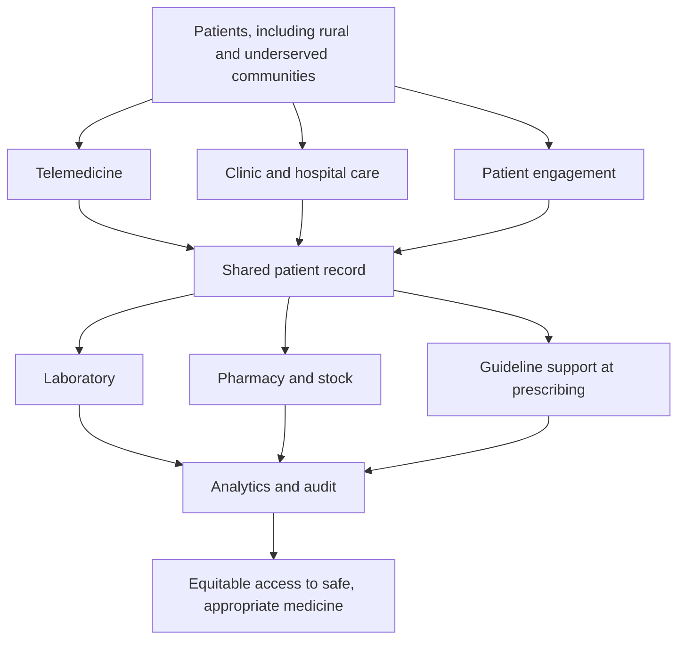
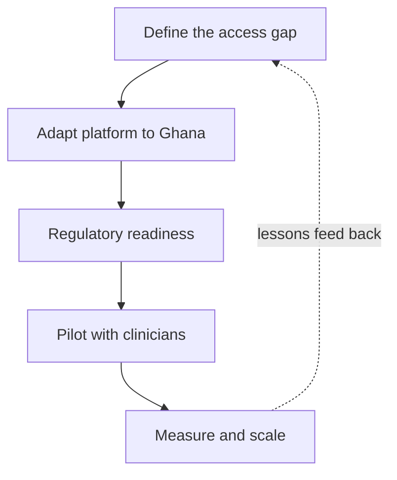
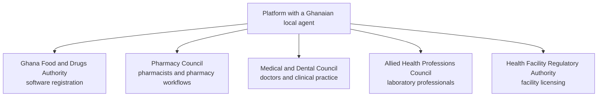
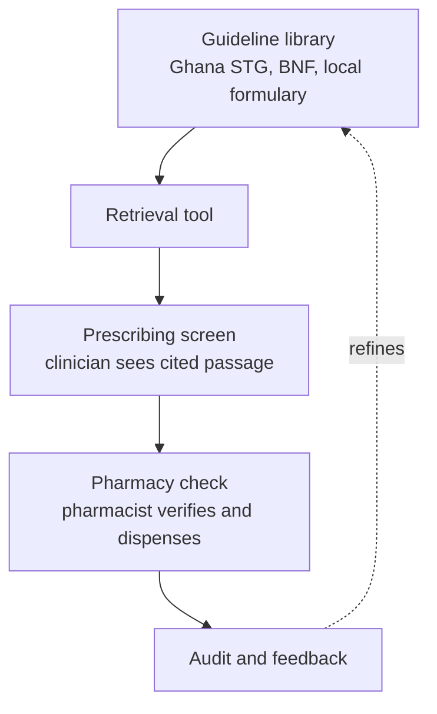
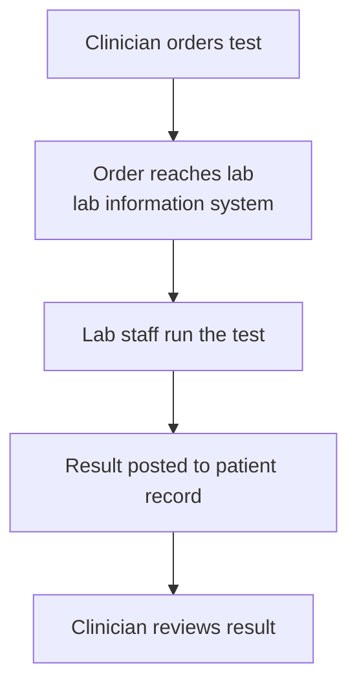
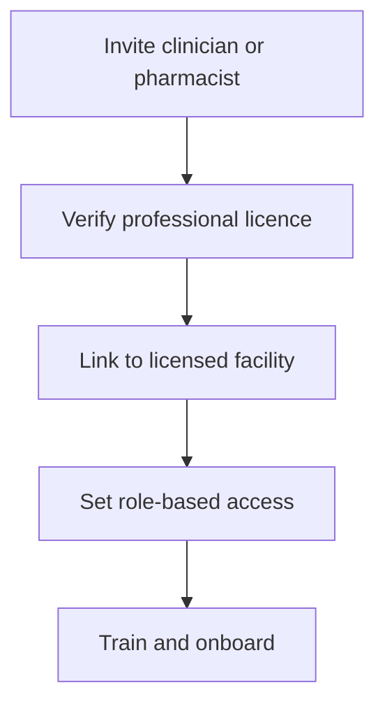

# Digital Health for Equitable Access to Medicine in Ghana

A clinician-led project adapting an integrated digital health platform to Ghana, so that patients can reach care, receive the right medicine, and be treated according to current guidelines wherever they live.

> Status: early-stage planning and proof of concept. The full platform has not been deployed in Ghana.

## The problem

In Ghana, access to safe, appropriate medicine is limited by more than the medicines themselves. Patients in rural and underserved communities face long and costly journeys to care. Records are fragmented between facilities. Pharmacy stock is hard to see and plan around. Prescribing guidelines are not always at hand at the point of care. These gaps compound each other, so they are best addressed together.

## The approach

Our team is working to adapt an integrated digital health platform to Ghana's context. The platform brings access, records, clinical services and insight into one system:

How each layer supports equity:

- Access: telemedicine and patient engagement tools reduce the need for long, costly travel.
- Records: a shared patient record keeps care continuous across facilities.
- Services: laboratory and pharmacy modules connect diagnosis to dispensing, and guideline support helps prescribers apply the Ghana Standard Treatment Guidelines and the BNF.
- Insight: analytics and audit show where access or prescribing gaps persist, so facilities and policymakers can act.

## Platform partner

We are in early, exploratory discussions with Altabeeb Healthcare, a healthcare technology company whose platform spans telemedicine, electronic medical records, hospital and clinic management, laboratory, pharmacy, analytics and patient engagement. Overview: [add the confirmed website link here].

No agreement is in place, and nothing in this repository describes commercial terms.

## Project workflow

1. Define the access gap: document where distance, stock and guideline use limit access to medicine.
2. Adapt the platform to Ghana: align the local formulary and treatment guidelines.
3. Regulatory readiness: engage the relevant Ghanaian health regulators and put data safeguards in place.
4. Pilot with clinicians: start with a small number of facilities and gather clinician feedback.
5. Measure and scale: track access and safety measures, then feed lessons back into the first stage.

## Proof of concept already in use

A guideline support tool, developed by [your name], is in active use at [hospital name] in Ghana. During prescribing and clinical audit it retrieves relevant passages from references such as the BNF and the Ghana Standard Treatment Guidelines. It shows how guideline support can work inside a real hospital workflow. The tool's code is not part of this repository.

## Team and roles

- [Your name]: developer of the guideline support tool; lead on the Ghana side.
- [Teammate name]: physician; clinical liaison. Connects patients and clinicians to the system, and advises on clinical safety, usability and local care pathways.

## Ghana rollout plan

### Regulatory approvals

The platform will be introduced through a registered Ghanaian local agent, who engages each relevant body. The exact requirements for each module are to be confirmed with the regulators directly.

### Guideline support at prescribing

Building on the proof of concept, guideline support runs inside the prescribing workflow, so the clinician sees the relevant passage and the pharmacist can verify before dispensing. Audit findings feed back into the guideline library.

### Laboratory integration

Test orders, results and clinical decisions stay linked to one patient record.

### Enrolling doctors and pharmacists

Professionals are verified before they are given access, and access is limited to their role.

## Equity and safety considerations

- Affordability and reach are considered at every stage, with a focus on underserved communities.
- Clinicians are involved from the start so the system fits real care pathways.
- Patient privacy comes first: no patient data is held in this repository, and any future outcome figures will be anonymised and cleared by the facility.
- Guideline support assists prescribers; the clinician remains responsible for the decision.

## Not included in this repository

Source code, patient data, API keys, copyrighted guideline texts (the BNF is cited as a source, not reproduced) and commercial terms.
